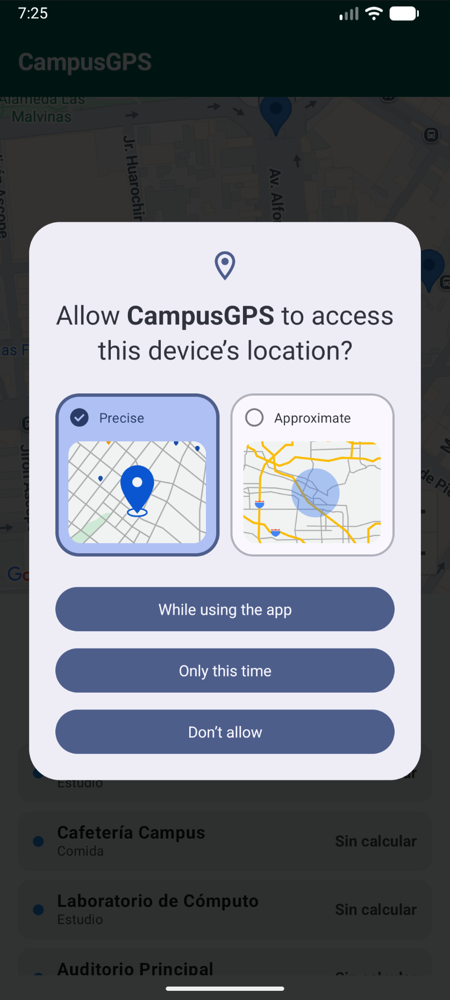
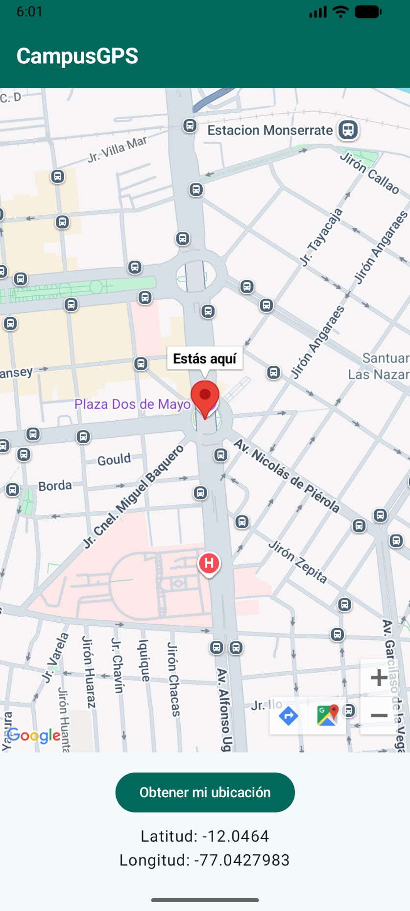
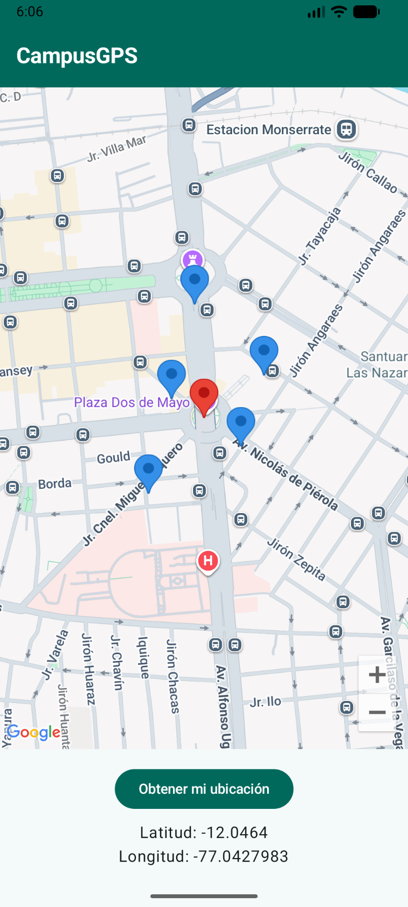
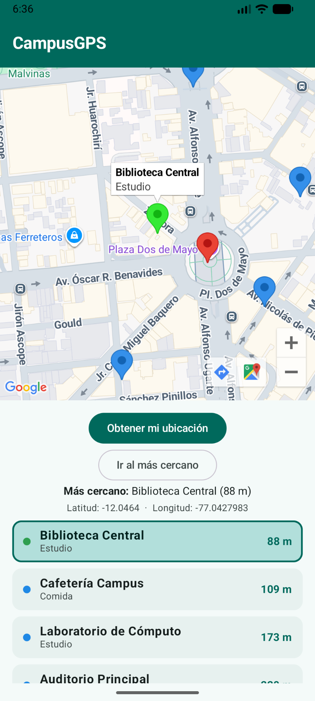
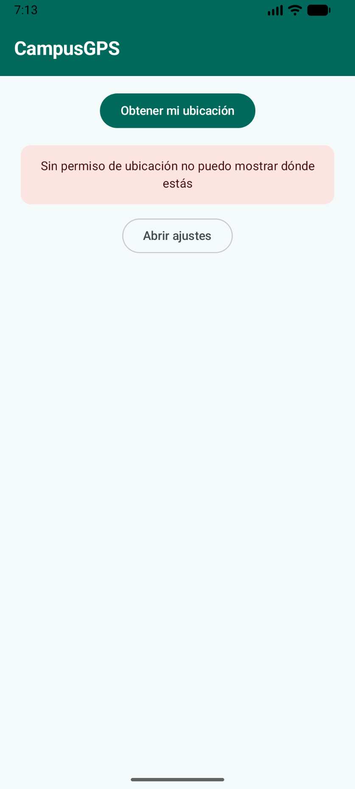
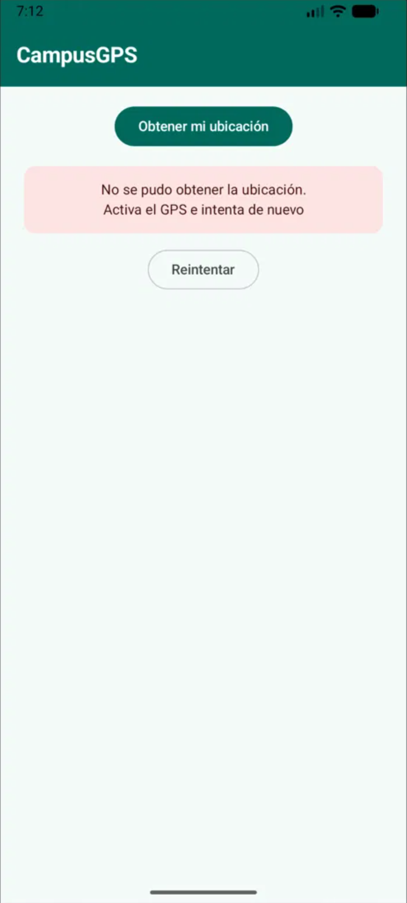

# CampusGPS

**Encuentra los puntos del campus más cercanos a ti.**

App Android que obtiene la ubicación del celular, la muestra en un mapa de Google y lista cinco lugares ficticios del campus (biblioteca, cafetería, laboratorio, auditorio y estacionamiento) **ordenados del más cercano al más lejano**, con su distancia en metros. El lugar más cercano se resalta en verde y un botón lleva la cámara hasta él.

La app sigue funcionando aunque el usuario **niegue el permiso**, **apague el GPS** o **no tenga Google Play Services**: en cada caso muestra un mensaje claro y una acción útil.

| Dato | Detalle |
|---|---|
| Alumno | Farid Chávez Campos |
| Curso | Programación en Móviles — TECSUP |
| Docente | Juan León S. |
| Laboratorio | N.° 13 — Localización Geográfica |
| Tecnología | Kotlin + Jetpack Compose + Material 3 (sin XML), Google Play Services Location, Maps Compose |
| Patrón | MVVM + Repository (interface) |

---

## Tecnologías y dependencias

```kotlin
implementation("com.google.android.gms:play-services-location:21.3.0")
implementation("org.jetbrains.kotlinx:kotlinx-coroutines-play-services:1.8.1")
implementation("com.google.maps.android:maps-compose:8.4.0")
implementation("androidx.lifecycle:lifecycle-viewmodel-compose:2.8.7")
```

- **Android Studio** con AGP 9.3.3 y **Kotlin 2.4.0**.
- **minSdk 24**, **targetSdk 37**.
- Tema propio de Material 3 con paleta **teal + ámbar** (sin colores por defecto ni color dinámico).

---

## Cómo ejecutar el proyecto

1. Clona el repositorio y ábrelo en Android Studio.
2. Crea una clave de **Maps SDK for Android** en Google Cloud, restringida al paquete `com.chavez.campusgps` y a tu huella SHA-1 (`./gradlew signingReport`).
3. Agrega la clave en `local.properties` (este archivo **no se sube** a GitHub):
   ```properties
   MAPS_API_KEY=tu_clave_aqui
   ```
4. Usa un emulador **con Google Play** y ponle la ubicación del punto base:
   **Extended controls → Location → `-12.0464, -77.0428` → Set location**.
5. Ejecuta la app y pulsa **Obtener mi ubicación**.

---

## Estructura de paquetes

```
com.chavez.campusgps/
├── MainActivity.kt                      Punto de entrada: crea el ViewModel con la factory
├── model/
│   └── Modelos.kt                       Posicion, Lugar, LugarConDistancia, TipoError, UbicacionUi
├── data/
│   ├── UbicacionRepository.kt           interface (+ UbicacionNoDisponibleException)
│   ├── UbicacionRepositoryGoogle.kt     implementación con FusedLocationProviderClient
│   ├── LugaresRepository.kt             interface
│   └── LugaresRepositoryLocal.kt        los 5 lugares ficticios
├── util/
│   ├── Distancia.kt                     distanciaMetros() con Location.distanceBetween
│   └── Formato.kt                       formatearDistancia(): "350 m" / "1.5 km"
├── viewmodel/
│   ├── MapaViewModel.kt                 estado, lugares, seleccionado, masCercano
│   └── CampusViewModelFactory.kt        crea el ViewModel con sus repositorios
└── ui/
    ├── PantallaMapa.kt                  pantalla principal + permisos
    ├── MapaUbicacion.kt                 GoogleMap, cámara y marcadores
    ├── ListaLugares.kt                  LazyColumn de tarjetas
    ├── MensajeError.kt                  recuadro de error + botón según el tipo
    └── theme/                           Color.kt, Theme.kt, Type.kt
```

---

## Arquitectura MVVM + Repository

```
View (PantallaMapa, MapaUbicacion, ListaLugares, MensajeError)
   │  evento: pulsar el botón / tocar una tarjeta        ▲  collectAsState()
   ▼                                                      │
ViewModel (MapaViewModel)  ──────── StateFlow ────────────┘
   │  llama a las interfaces
   ▼
UbicacionRepository  ───►  UbicacionRepositoryGoogle  (FusedLocationProviderClient)
LugaresRepository    ───►  LugaresRepositoryLocal     (los 5 lugares fijos)

util/  ───►  funciones puras: distanciaMetros(), formatearDistancia()
```

| Capa | Conoce a | No hace |
|---|---|---|
| **View** (`ui/`) | Solo a su ViewModel | No usa Repository ni `FusedLocationProviderClient` ni calcula distancias |
| **ViewModel** | Solo a las interfaces de Repository | No conoce Composables ni recibe un `Context` |
| **Repository** | Google Play Services | No expone clases de UI |
| **util/** | Nada (funciones puras) | No guarda estado |

### Estados de la pantalla

```kotlin
sealed interface UbicacionUi {
    data object Inicial : UbicacionUi
    data object Buscando : UbicacionUi
    data class Lista(val posicion: Posicion) : UbicacionUi
    data class Error(val mensaje: String, val tipo: TipoError) : UbicacionUi
}
```

| Tipo de error | Mensaje | Acción |
|---|---|---|
| `SIN_PERMISO` | Sin permiso de ubicación no puedo mostrar dónde estás | **Abrir ajustes** |
| `GPS_APAGADO` | No se pudo obtener la ubicación. Activa el GPS e intenta de nuevo | **Reintentar** |
| `SIN_PLAY_SERVICES` | Este dispositivo no tiene Google Play Services | Sin botón |
| `OTRO` | Mensaje de la excepción | **Reintentar** |

---

## Capturas

| 1. Permiso | 2. Mapa con tu ubicación | 3. Marcadores |
|:---:|:---:|:---:|
|  |  |  |

| 4. Lista ordenada y más cercano | 5. Error (permiso denegado) | 6. Error (GPS apagado) |
|:---:|:---:|:---:|
|  |  |  |

> Capturas tomadas con el emulador en el punto base `-12.0464, -77.0428`.

---

## Pruebas de aceptación

| # | Prueba | Resultado esperado | OK |
|---|---|---|:---:|
| 1 | Abrir la app por primera vez y pulsar el botón | Aparece el cuadro de permiso | ✅ |
| 2 | Aceptar el permiso | Se ven latitud, longitud y el marcador **Estás aquí** | ✅ |
| 3 | Negar el permiso | Mensaje de error con **Abrir ajustes**, la app no se cierra | ✅ |
| 4 | Ubicación en el punto base | Los 5 marcadores azules aparecen cerca de tu posición | ✅ |
| 5 | Tocar un marcador | Se ven el nombre y la categoría del lugar | ✅ |
| 6 | Lista de lugares | Ordenada de menor a mayor distancia, con `m` o `km` | ✅ |
| 7 | Tocar una tarjeta de la lista | La cámara viaja a ese lugar y la tarjeta queda resaltada | ✅ |
| 8 | Ir al más cercano | La cámara va al lugar verde; el botón está deshabilitado antes de buscar | ✅ |
| 9 | Cambiar la ubicación del emulador y buscar otra vez | Las distancias, el orden y el lugar verde se actualizan | ✅ |
| 10 | Ubicación apagada | Mensaje de GPS con **Reintentar** | ✅ |
| 11 | Rotar la pantalla | No se pierden la ubicación ni la lista | ✅ |
| 12 | Revisar el repositorio | `git grep` no encuentra la clave y `local.properties` no está subido | ✅ |

Distancias obtenidas en el punto base (Logcat, tag `CampusGPS`):

```
1. Biblioteca Central: 88 m
2. Cafetería Campus: 109 m
3. Laboratorio de Cómputo: 173 m
4. Auditorio Principal: 220 m
5. Estacionamiento Norte: 266 m
```

---

## Problemas que encontré y cómo los resolví

| Problema | Causa | Solución |
|---|---|---|
| Error `incompatible version of Kotlin... metadata version is 2.4.0` al compilar | `maps-compose:8.4.0` está compilada con Kotlin 2.4.0 y el proyecto usaba una versión anterior | Subí `kotlin = "2.4.0"` en `gradle/libs.versions.toml` |
| `Unresolved reference 'util'` en `build.gradle.kts` | En un script de Gradle, `java` choca con la extensión `java { }`, así que `java.util.Properties()` no se resuelve | Importé la clase con `import java.util.Properties` al inicio del archivo |
| Al cambiar de ubicación, el más cercano quedaba oculto arriba de la lista | `LazyColumn` con `key` conserva la posición del elemento que estaba primero | `LaunchedEffect(lugares) { estadoLista.scrollToItem(0) }` en `ListaLugares` |
| "Ir al más cercano" no movía la cámara después de una nueva búsqueda | `seleccionado` ya tenía ese id, así que `LaunchedEffect(seleccionado)` no se volvía a ejecutar | Limpio la selección (`_seleccionado.value = null`) en cada búsqueda exitosa |

---

## Para pensar

### 1. ¿Por qué `FusedLocationProviderClient` está dentro del Repository y no en el ViewModel?

Porque el ViewModel no debe depender de Android ni de Google. `FusedLocationProviderClient` necesita un `Context` para crearse, y si el ViewModel guardara un `Context` podría causar fugas de memoria (el ViewModel vive más que la Activity) y rompería la regla de MVVM del laboratorio.

El ViewModel solo conoce la **interface** `UbicacionRepository` y pide `obtenerPosicion()`. No sabe si la ubicación viene de Google, de un GPS externo o de datos falsos. Gracias a eso podría cambiar la implementación (por ejemplo, un repositorio falso para pruebas unitarias) sin tocar una sola línea del ViewModel.

### 2. ¿Qué diferencia hay entre el permiso de ubicación y la clave de API de Maps? ¿Qué pasa si falta cada uno?

Son dos servicios distintos de Google con dos controles distintos:

| | Permiso de ubicación | Clave de API de Maps |
|---|---|---|
| **Quién lo da** | El **usuario**, en tiempo de ejecución | **Google Cloud**, al desarrollador |
| **Para qué sirve** | Que la app pueda **leer dónde está el celular** | Que la app pueda **descargar y dibujar el mapa** |
| **Dónde se configura** | `<uses-permission>` en el Manifest + pedirlo con `RequestMultiplePermissions` | `local.properties` → `manifestPlaceholders` → `<meta-data>` en el Manifest |
| **Si falta** | El mapa se ve, pero no hay ubicación: la app muestra "Sin permiso de ubicación..." con **Abrir ajustes** | Hay ubicación, pero el mapa sale **gris o en blanco** (en Logcat: `Authorization failure`) |

### 3. ¿Por qué la clave va en `local.properties` y no en el código? ¿Qué harías si se subiera a GitHub por error?

Porque `local.properties` está en el `.gitignore` y **nunca se sube** al repositorio. Si la clave estuviera en el código o directamente en el Manifest, cualquiera que vea el repositorio podría copiarla y usarla, y el consumo (y posibles cobros) correría por mi cuenta. Gradle la lee al compilar y la pasa al Manifest con `manifestPlaceholders`, así que la app funciona sin que la clave aparezca en ningún archivo versionado.

Si se subiera por error:
1. **Borraría esa clave en Google Cloud de inmediato** y crearía una nueva. Borrar el archivo del repositorio no basta, porque la clave queda en el historial de Git y ya se considera expuesta.
2. Pondría la clave nueva solo en `local.properties`.
3. Revisaría que `local.properties` esté en el `.gitignore` y lo comprobaría con `git status` y `git grep`.
4. Mantendría la clave **restringida** al paquete `com.chavez.campusgps` y a mi SHA-1, para que aunque alguien la copie no le sirva en otra app.

### 4. ¿Dónde calculas la distancia y por qué no en el Composable?

La calculo en el **ViewModel**, en la función privada `actualizarDistancias()`, que usa la función pura `distanciaMetros()` de `util/`. Solo se llama dentro de `buscar()`, cuando la ubicación llega con éxito. Ahí se crea la lista de `LugarConDistancia`, se ordena con `sortedBy { it.metros }` y se publica en `_lugares`.

No va en el Composable porque:
- **Un Composable se vuelve a ejecutar muchas veces** (en cada recomposición: al tocar una tarjeta, al mover el mapa...). El cálculo se repetiría sin necesidad.
- **La pantalla debe dibujar según el estado, no calcularlo.** Esa es la regla de oro de MVVM.
- En el ViewModel el resultado **sobrevive a la rotación** de la pantalla y se puede **probar** sin interfaz.
- Las vistas solo **formatean** el número ya calculado con `formatearDistancia()`.

### 5. ¿Qué pasa con tu app si el usuario niega el permiso dos veces? ¿Cómo lo manejas?

Desde Android 11, si el usuario niega el permiso **dos veces**, Android lo considera "denegado de forma permanente" y **ya no vuelve a mostrar el cuadro**. Cuando la app llama a `lanzador.launch(...)`, el sistema responde de inmediato con todos los permisos en `false`, sin preguntar.

Mi app lo maneja así:
1. El callback del lanzador recibe todo en `false` y llama a `vm.permisoDenegado()`.
2. El ViewModel cambia el estado a `Error(..., TipoError.SIN_PERMISO)`.
3. `MensajeError` muestra el mensaje y el botón **Abrir ajustes**, que lanza un `Intent` con `Settings.ACTION_APPLICATION_DETAILS_SETTINGS` y `Uri.fromParts("package", packageName, null)`.
4. Eso abre la pantalla de la app en Ajustes, donde el usuario puede activar el permiso a mano. Al volver, pulsa **Obtener mi ubicación** y funciona.

La app **nunca se cierra** y el usuario siempre tiene una salida.